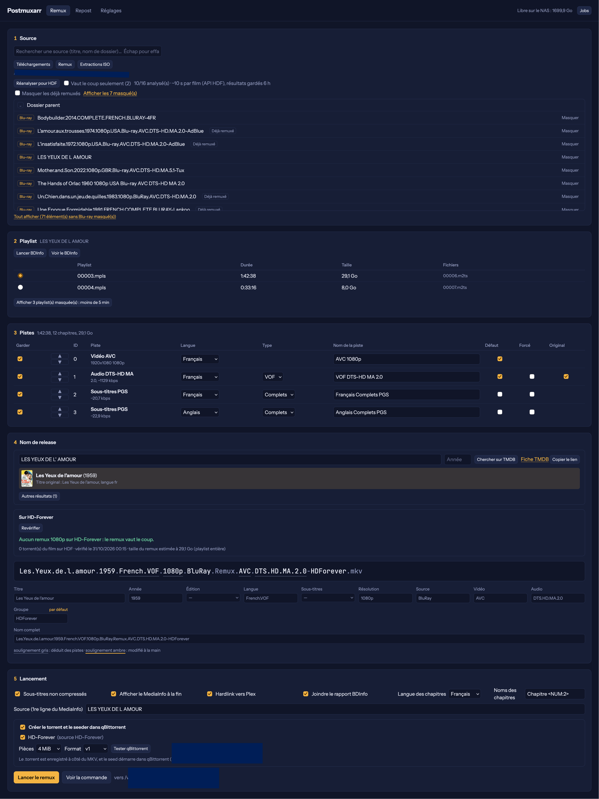
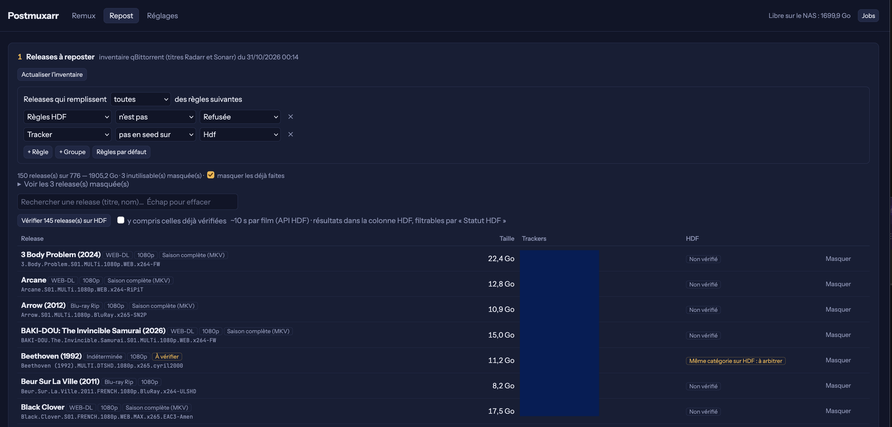

# Postmuxarr

Web app Docker pour les membres de HD-Forever, en deux volets :

- **Remux** : Blu-ray (dossier BDMV ou ISO) → MKV avec mkvmerge. Choix de la playlist, des pistes, des langues et des
  drapeaux, nom de release au format scene avec ton tag, BDInfo, MediaInfo, torrent créé et seedé dans qBittorrent,
  hardlink vers la bibliothèque, vérification des doublons sur HD-Forever avant de remuxer.
- **Repost** : reprend des releases déjà en seed dans qBittorrent et les prépare pour HD-Forever. Les fichiers des
  autres seeds ne sont jamais modifiés.
  - Inventaire lu dans **qBittorrent** (les cross-seeds d'une même release sont regroupés). Avec **Radarr** et
    **Sonarr** (facultatifs), titre et fiche TMDB exacts de chaque release, d'après leur historique.
  - Releases repostables : un film en MKV, une saison complète (dossier d'épisodes MKV), un FULL Blu-ray (BDMV ou ISO).
  - Filtres à règles (tracker, catégorie, taille, nom, résolution, contenu…) et champ « Règles HDF » : ce que les
    règles d'upload refusent d'après le nom et le contenu (DVD, CAM/TS, WEBRip, 720p, épisode seul, mHD hors teams
    autorisées…).
  - Analyse MediaInfo d'une release : débit ou CRF minimum, réglages x264, 10 bits, formats audio, VF, VO et
    sous-titres français, core DTS, TrueHD sans AC3, chapitres.
  - Vérification sur HD-Forever par son API : doublon, identique (cross-seed sans rien télécharger), sans seeder.
  - Torrent créé sur les mêmes fichiers, MediaInfo ou BDInfo prêt, puis upload depuis le bouton du job.

Les traitements longs sont des jobs côté serveur : le navigateur peut être fermé.

> **Sécurité** : sans la protection par mot de passe (voir Accès), toute personne de ton réseau peut ouvrir
> Postmuxarr. Ne l'expose pas sur Internet, et jamais sans HTTPS : en HTTP, le mot de passe circule en clair.

## Aperçu

## Prérequis

- **Docker** avec Docker Compose, sur une machine **x86_64 (amd64)** : NAS Synology à processeur Intel ou AMD
  (Container Manager), Unraid, serveur Linux… Les machines ARM (Raspberry Pi, NAS ARM) ne sont pas prises en charge
  pour l'instant (binaire BDInfo amd64).
- **qBittorrent 5.0 ou plus**, WebUI activée et joignable depuis le conteneur (création de torrents par son API).
  Clé API possible à partir de la 5.2, sinon identifiant et mot de passe.
- **Mêmes fichiers vus par Postmuxarr et par qBittorrent** : les dossiers de médias montés dans le conteneur, avec
  la correspondance des chemins à régler dans Réglages. Pour le Repost, le dossier des hardlinks doit être sur le même
  volume que les releases.
- **Clé API HD-Forever** (HDF ▸ Intégrations ▸ API) : vérification des doublons, cross-seed, userscript de
  disponibilité. Facultative, mais sans elle aucune vérification sur HDF.
- **Clé TMDB** (gratuite, themoviedb.org ▸ Paramètres ▸ API) : identification des films et séries, langue
  originale. Facultative, recommandée.
- **Radarr et Sonarr** (facultatifs, une ou plusieurs instances) : adresse et clé API. Leur historique donne le titre
  et la fiche TMDB exacts des releases du Repost, sans recherche par le nom.
- **Remux** (facultatif, le Repost s'en passe) : Blu-ray déjà déchiffrés (dossier BDMV ou ISO, par exemple sauvegardés
  avec MakeMKV) ; mkvmerge ne lit pas un disque protégé par AACS. Prévoir l'espace libre du remux, plus la taille de
  l'ISO pour une extraction temporaire.
- **Userscripts** (facultatifs) : Violentmonkey ou Tampermonkey (voir Userscripts ▸ Compatibilité).
- **Réseau local** : Postmuxarr n'est pas fait pour être exposé sur Internet.

## Installation

L'image est publiée sur `ghcr.io/gusdezup/postmuxarr` (amd64) à chaque version.

1. Dans le dossier du stack, créer un dossier `postmuxarr` et y copier `config.example.yml` sous le nom
   `config.yml`. Ce fichier n'est jamais versionné. Il garde les conventions de nommage et l'URL d'annonce de chaque
   tracker (avec ta passkey) ; tout le reste se règle dans l'interface.
2. Ajouter le service de `docker-compose.example.yml` au `docker-compose.yml` du stack, et adapter les chemins.
   Les médias doivent être montés au même chemin que sur l'hôte, en un seul montage (hardlinks).
3. `sudo docker compose up -d postmuxarr`, puis http://NAS:8790
4. Onglet **Réglages** : connexion à qBittorrent (avec le bouton Tester, qui vérifie aussi la correspondance des
   chemins), clé TMDB, clé API HD-Forever, et Radarr et Sonarr si tu les utilises.

## Réglages

L'onglet Réglages regroupe :

- **qBittorrent** : adresse, clé API (qBittorrent 5.2 et plus) ou utilisateur et mot de passe, catégories et tags,
  correspondance des chemins (dossier vu par Postmuxarr → même dossier vu par qBittorrent).
- **Services** : clé TMDB, clé API HD-Forever (HDF → Intégrations → API), Radarr et Sonarr (facultatifs, autant
  d'instances que tu veux : nom, adresse et clé API ; Postmuxarr lit seulement leur historique), noms affichés des trackers.
- **Remux et règles d'upload HDF** : tag des releases, team de la dérogation au doublon, tolérance de taille,
  termes interdits, teams mHD, seuils de débit et de CRF, réglages x264 minimum, formats audio admis, chapitres…
  Valeurs par défaut : règles d'upload de HD-Forever d'octobre 2026. Seules tes modifications sont enregistrées ;
  « Critères par défaut » y revient.

Les réglages sont stockés dans `/data` (base de l'app). Les clés et mots de passe ne sont jamais renvoyés à la page.
Les variables d'environnement (`QBT_API_KEY`, `TMDB_API_KEY`, `HDF_API_KEY`)
et `config.yml` restent acceptés en repli : l'interface est prioritaire.

## Accès

Protection facultative, désactivée par défaut : Réglages ▸ Accès à Postmuxarr, identifiant et mot de passe
(8 caractères minimum, stocké haché). Le navigateur les demande une fois par session. Les userscripts passent par
la clé API affichée au même endroit (en-tête `X-Api-Key`).

Mot de passe perdu : ajouter `POSTMUXARR_NO_AUTH=1` à l'environnement du service, `sudo docker compose up -d
postmuxarr`, désactiver la protection dans Réglages, puis retirer la variable et recommencer.

## Userscripts

Fournis dans `app/userscripts` et installés depuis Réglages ▸ Userscripts dans ton gestionnaire de userscripts
(Violentmonkey ou Tampermonkey conseillés, voir Compatibilité) : Postmuxarr les sert avec son adresse et la clé API
déjà remplies, et le gestionnaire les met à jour depuis Postmuxarr.

- **Disponibilité sur HD-Forever** : sur PTP, ABN, TR4KER, Nostradamus et C411, indique si le film est sur HDF, dans
  quels formats, et si chaque release de la page y serait un doublon.
- **Upload sur HD-Forever** : sur hdf.world, remplit le formulaire d'upload depuis un job de Postmuxarr (bouton
  « Uploader sur HD-Forever » du job) : TMDB, .torrent, MediaInfo ou BDInfo, catégorie, langues, sous-titres,
  versions. L'envoi reste manuel ; une fois l'upload accepté, Postmuxarr réannonce jusqu'au feu vert du tracker.

### Compatibilité

Les scripts utilisent l'API `GM_*` et, à défaut, `GM.*` : ils devraient fonctionner avec tous les gestionnaires
courants. Seule la combinaison Violentmonkey + Firefox est testée ; le reste est attendu d'après l'API de chaque
gestionnaire.

| Gestionnaire | Navigateurs | État |
|---|---|---|
| Violentmonkey | Firefox | Testé. |
| Violentmonkey | Chrome, Edge, Brave | A priori compatible, si l'extension est encore disponible pour ton navigateur (Manifest V3). |
| Tampermonkey | Firefox, Chrome, Edge, Brave, Safari | A priori compatible (même API). Chrome et Edge récents : activer « Autoriser les scripts utilisateur » dans les détails de l'extension. |
| Greasemonkey 4 | Firefox | A priori compatible (API `GM.*`), non testé. Pas de mise à jour automatique : réinstaller depuis Réglages. |
| Userscripts (app) | Safari (macOS, iOS) | Partiel, non testé. Disponibilité : a priori OK. Upload : formulaire rempli, mais le MediaInfo ne se colle sans doute pas tout seul (éditeur de la page inaccessible) : bouton « Copier le MediaInfo ». Mises à jour automatiques non garanties. |

Si « Installer » n'ouvre pas la page d'installation du gestionnaire, ouvre le lien, copie le script et crée-le à la
main dans le gestionnaire. Postmuxarr reste en HTTP sur le réseau local : les requêtes passent par le gestionnaire,
pas par la page du tracker, et ne sont donc pas bloquées comme contenu mixte.

## Versions et mises à jour

Numérotation [SemVer](https://semver.org/lang/fr/), notes de chaque version dans les
[Releases](https://github.com/Gusdezup/postmuxarr/releases) et dans `CHANGELOG.md`. La version en cours est affichée
à côté du nom de l'app (lien vers ses notes). Tant que Postmuxarr est en 0.x, une version mineure (0.2.0…) peut
demander une modification de `config.yml` ou du service Docker : ses notes le disent.

Tags de l'image : `0.1.4` (version exacte), `0.1` (dernière 0.1.x), `latest` (dernière version).

- Mise à jour, quand aucun job n'est en cours :
  `sudo docker compose pull postmuxarr && sudo docker compose up -d postmuxarr`
- Retour à une version précédente : la mettre dans `image:` (par exemple `ghcr.io/gusdezup/postmuxarr:0.1.3`), puis
  la même commande.
- `config.yml` modifié : rien à faire, il est relu à chaque utilisation (sauf `paths`, lu au démarrage :
  `sudo docker compose restart postmuxarr`).
- Construction depuis le dépôt (`build: ./postmuxarr` à la place de `image:`) : `git pull`, puis
  `sudo docker compose up -d --build postmuxarr`.

## Structure

- `app/main.py` : backend FastAPI
- `app/static/index.html` : interface
- `Dockerfile` : Python 3.12 Alpine + mkvtoolnix, mediainfo, 7-Zip, go-bdinfo
- `config.example.yml` : modèle de configuration
- `docker-compose.example.yml` : service à ajouter au stack
- `CHANGELOG.md` : notes de version
- `scripts/release.sh` : publication d'une version (tag, image, release)
